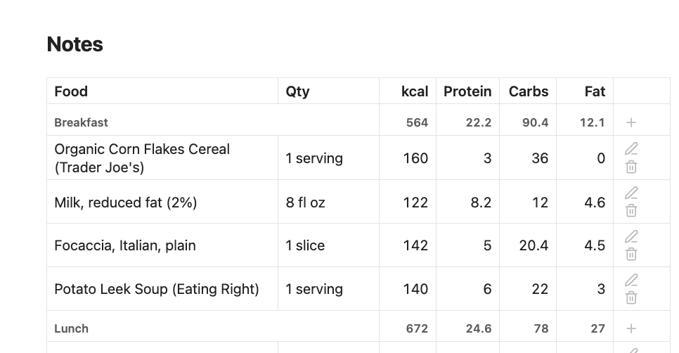
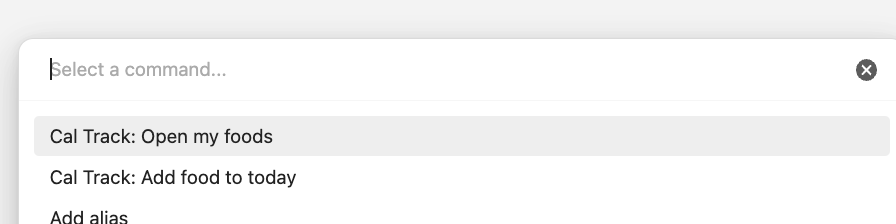
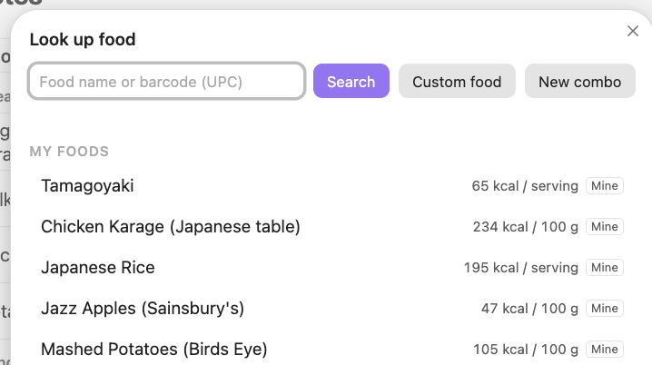
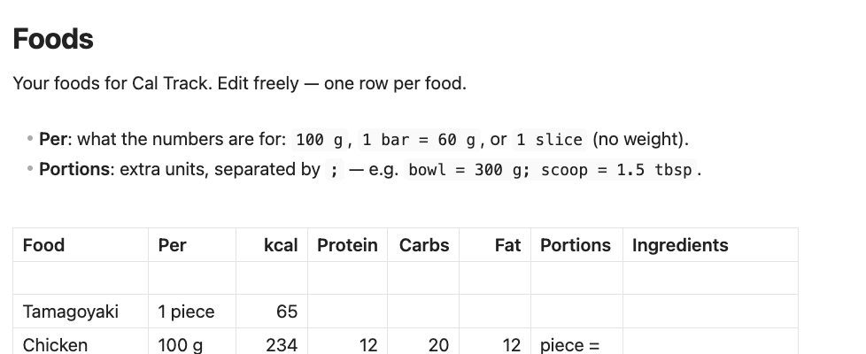

# Cal Track — Obsidian Plugin

Log what you eat into your daily notes. Search a food database, pick a quantity and unit ("1 medium", "2 tbsp", "150 g", "6 oz"), and Cal Track records the calories and macros. Each daily note shows that day's foods with live totals.



Every entry goes into one CSV file in your vault, `Cal Track/log.csv`, with one row per food eaten:

```csv
id,date,time,meal,food,qty,unit,kcal,protein,carbs,fat
mgx3k2a1b,2026-10-15,08:05,Breakfast,"Bananas, raw",1,medium,105,1.3,26.9,0.4
mgx3m9c4d,2026-10-15,12:30,Lunch,Oats,40,g,150,5,27,2.5
```

Your daily notes don't hold any food data. Each one has a `cal-track` block that shows the rows for its date:

````markdown
```cal-track
```
````

It renders as a table, grouped by meal with a subtotal for each, with Total (and Goal / Remaining, if you set a goal), buttons to adjust or remove each food, and an **Add food** button. It updates as soon as the log changes, including when you edit the CSV by hand.

> **Requires daily notes.** Turn on daily notes in the [Periodic Notes](https://github.com/liamcain/obsidian-periodic-notes) plugin or Obsidian's core **Daily notes** plugin. Cal Track uses their folder, date format and template.

> **Syncing:** all your entries live in that one CSV file. If you log food on two devices before they've synced with each other (say, on your phone while offline, then on your laptop), your sync service ends up with two different versions of the file, and may not combine them:
> - **Obsidian Sync** merges changes in Markdown notes, but not in other files such as this CSV. For those, the newer version wins, so the other device's entries can be lost without warning.
> - **iCloud, Dropbox, Syncthing and others** usually keep one version and save the other as a conflict copy next to it (e.g. `log (conflicted copy).csv`). The entries in the copy are safe, but Cal Track won't show them until you paste them back into `log.csv`.
> - **Git** reports a merge conflict for you to resolve.
>
> To avoid it, let a device finish syncing before you log food on another one.

---

## Getting started

1. Install Cal Track (see [Installation](#installation-manual)) and turn on daily notes: the **Periodic Notes** plugin, or Obsidian's core **Daily notes** plugin.
2. Run **Add food to today** from the command palette, or tap 🍴 in the ribbon.

   
3. Type a food and press **Enter** to search. Pick a result, set the quantity, unit and meal, and tap **Add**.
4. Cal Track opens today's note. It's created from your daily note template if it didn't exist yet, with a food log at the bottom showing what you just added.

From then on, use **Add food** in that log, or the command again. Optionally, [get a free USDA key](#getting-a-usda-key) for more reliable searches, and set a daily calorie goal in settings.

## Using it

| Command | What it does |
|---------|--------------|
| **Add food to today** | Search → pick a quantity, unit and meal → adds the food to today's log, then opens today's note. Creates the note from your template if it doesn't exist yet, and adds the `cal-track` block to it if it's missing. Also on the ribbon (🍴). |
| **Open today's food log** | Opens today's daily note, creating it (with the block) if needed. |
| **New combo** | Saves several foods as one, for meals you eat often or recipes. See Combos. |
| **Open my foods** | Opens your food database note, creating it if needed. |

In a daily note's block:
- **Add food** logs to that note's day, so you can fill in yesterday from yesterday's note.
- ✏️ changes a food's quantity or unit, and calories and macros recalculate. **Different food…** swaps the food.
- 🗑 removes it.
- ➕ next to a meal heading adds a food to that meal.

### Meals

When you add a food, pick a meal for it next to the quantity and unit: Breakfast, Lunch, Dinner or Snack by default, or your own list in settings. For today's foods the picker starts on a guess from the time of day (breakfast before 11:00, lunch until 15:00, dinner 17:00–22:00, otherwise snack). Pick **No meal** to leave it unlabeled. ✏️ changes a food's meal later.

The daily log groups foods under their meals, in your list's order, with a subtotal for each. Meals you've since removed from the list still show, after the others. If no food that day has a meal, the log is a plain list.

A log file from before meals were added gets the new `meal` column the next time Cal Track writes to it; existing rows are kept, with no meal.

A block outside a daily note needs a date: put a line like `date: 2026-10-15` inside it.

### The log file

`log.csv` is a normal CSV file, so you can open it in Excel, Numbers or Google Sheets to chart your history. Obsidian doesn't show CSV files in the file explorer unless you turn on **Settings → Files and links → Detect all file extensions**.

You can edit it by hand. Columns are found by header name, so a file with columns in another order still reads, and rows without an `id` get one the next time Cal Track writes the file. Cal Track rewrites the whole file in its own column order when you adjust or remove a food, so extra columns you added are dropped.

### Barcodes

Type or paste the number under a barcode (UPC-A, EAN-8/13, GTIN-14; spaces and dashes are fine) into the search box. Cal Track looks it up on Open Food Facts and in USDA's branded foods instead of running a text search. A 12- or 13-digit number is looked up as soon as it's complete; press Enter for other lengths. If there's no product for that number, Cal Track tells you which databases it checked, or why one couldn't be checked (e.g. rate limited), with an **Add from label** button to enter the food from its nutrition label.

### Units

- **Portions from the database**: `medium`, `slice`, `serving`, `cup`… using the database's own gram weight.
- **Mass**: `g`, `oz`, `lb`, `kg`, `mg`, always available.
- **Volume**: `cup`, `tbsp`, `tsp`, `ml`, `fl oz`, `l`. These are offered only when the database gives a volume portion for that food, so the density is known. Otherwise "1 cup of flour" would just be a guess.

### Food sources

| Source | Good for | Key |
|--------|----------|-----|
| [USDA FoodData Central](https://fdc.nal.usda.gov/) | Generic foods (banana, chicken breast) and US brands | Optional. Without one, Cal Track uses the shared `DEMO_KEY`, which USDA currently limits to 10 lookups an hour per network (its docs say 30 an hour, 50 a day). A [free personal key](#getting-a-usda-key) gives 1,000 an hour. |
| [Open Food Facts](https://world.openfoodfacts.org/) | Packaged foods worldwide | None |
| **My foods** | Your own foods and portions, kept in a note in your vault | — |



Typing filters **My foods** and recently used foods instantly. To search USDA and Open Food Facts, press **Enter** or tap **Search**. Results show under your own foods. Online searches don't run as you type: Open Food Facts allows 10 searches a minute and asks apps not to search on every keystroke, and USDA's shared `DEMO_KEY` allows only about 10 lookups an hour. A complete 12- or 13-digit barcode is the exception (see Barcodes).

**Caching:** a search is cached for 10 minutes, and a food's full portion list (the extra request USDA needs for "1 medium", "1 cup", etc.) is cached for an hour — so searching again, reopening "Adjust" on the same food, or picking the same food twice doesn't cost another request. If a source returns a 429 (rate limited), it's skipped automatically for the next 15 minutes rather than retried on every search; the status line says how long is left. The `DEMO_KEY` quota is shared across every user of this plugin without their own key, so it can already be used up before you've searched anything yourself — a [personal key](https://fdc.nal.usda.gov/api-key-signup) isn't shared and clears any active cooldown as soon as you save it.

### Getting a USDA key

A personal key is free and takes about a minute. Open Food Facts doesn't need one.

1. Go to [fdc.nal.usda.gov/api-key-signup](https://fdc.nal.usda.gov/api-key-signup).
2. Enter your first name, last name and email address, and submit. Your key appears on the page and is emailed to you.
3. In Obsidian, open **Settings → Cal Track → USDA API key**:
   - **Obsidian 1.11.4 or later:** choose **Create new secret**, give it a name (e.g. `usda`), and paste the key. It's saved in Obsidian's keychain (Settings → Keychain), not in the plugin's files.
   - **Older versions:** paste the key into the text field.

   It works right away.

Your key allows 1,000 lookups an hour, just for you, instead of sharing `DEMO_KEY` with everyone else. It's an api.data.gov key, so it also works with other U.S. government APIs.

**Where the key is kept:**
- **In the keychain (1.11.4+):** stored on that device only, outside your vault, and not synced. Cal Track saves just the secret's name. Set the key once on each device you use. If a device doesn't have it yet, settings say so and that device uses `DEMO_KEY` until you do.
- **In the text field (older versions):** saved in plain text in `.obsidian/plugins/cal-track/data.json`, which syncs with your vault. If you publish your vault or keep it in a public Git repo, leave that file out. A leaked key can't access anything of yours, but others could use up its hourly limit.

If you saved a key before updating to 1.11.4, settings offer **Move your key to the keychain**, which moves it and removes it from `data.json`.

### My foods

Your own food database is a normal note, `Cal Track/Foods.md` by default (you can change the path in settings). You can read it, edit it by hand, and it syncs with the rest of your vault:



In Markdown:

```markdown
| Food | Per | kcal | Protein | Carbs | Fat | Portions |
| --- | --- | ---: | ---: | ---: | ---: | --- |
| Protein bar | 1 bar = 60 g | 240 | 20 | 25 | 8 | |
| Salmon, cooked | 100 g | 206 | 22.1 | 0 | 12.4 | fillet = 154 g; my plate = 6 oz |
| Mom's lasagna | 1 slice | 450 | | | | big slice = 1.5 slice |
```

- **Per** says what the numbers are for: `100 g`, `40 g`, `1 bar = 60 g`, or `1 slice`. With no weight, only slices (and portions defined in slices) can be logged.
- **Portions** are extra units, separated by `;`, each written `name = quantity unit`. A portion can use any unit the food already has.

Ways foods get there:
- **Custom food** in the search box: type in a nutrition label.
- **Save as portion…** in the quantity picker: name the current amount ("my bowl") and it becomes a unit for that food. This works on online foods too, and saves them to My foods.
- **Save to my foods** in the quantity picker: keeps an online food, so it's found instantly and works offline.
- **Open my foods** command: edit the note directly. Changes apply on the next search.
- **New combo** in the search box or the command palette: several foods saved as one (see below).

### Combos

A combo is several foods saved as one entry in My foods, so something you eat often takes one step to log. It could be your usual breakfast (oats, a banana, a cup of milk) or a recipe (a pot of chili that makes 6 servings).

1. Tap **New combo** in the search box, or run the **New combo** command.
2. Name it, and add each food with its amount the usual way (search, then quantity and unit).
3. Set **Servings** to how many servings it makes: 1 for a single meal, more for a recipe.
4. **Save.** If you started from the search box, the quantity picker opens next so you can log it right away.

It's logged as a single row, `1 serving` by default. A combo that makes several servings also has a `batch` unit for the whole thing. If every food in it has a known weight, you can log it in grams too. In search results it's marked **Combo**.

To change one, pick it and choose **Edit combo…** in the quantity picker. Foods you've already logged keep the numbers they were logged with.

In `Foods.md` a combo is an ordinary row with its totals per serving, plus an **Ingredients** column:

```markdown
| Food | Per | kcal | Protein | Carbs | Fat | Portions | Ingredients |
| --- | --- | ---: | ---: | ---: | ---: | --- | --- |
| Usual breakfast | 1 serving = 402 g | 377 | 14.3 | 66 | 2.9 | | Oats (40 g); Bananas, raw (1 medium); Milk (1 cup) |
```

The row's numbers are what gets logged. The ingredient list is only used when you edit the combo, so if you change it by hand, the numbers won't update. A food in the list that Cal Track can no longer find (e.g. after **Clear recent foods**) shows as "not found" in the editor, and you can look it up again there. An existing `Foods.md` gets the Ingredients column when you save your first combo.

---

## Network use

Cal Track connects to two food databases, and only when you look up a food. You can turn either one off in settings, and then it isn't contacted at all.

| Service | When | What's sent |
|---|---|---|
| [USDA FoodData Central](https://fdc.nal.usda.gov/) (`api.nal.usda.gov`) | You search (Enter or **Search**), enter a complete barcode, or pick a USDA food that needs its full portion list | Your search text or barcode, the USDA food ID, and your USDA API key (or the shared `DEMO_KEY`) |
| [Open Food Facts](https://world.openfoodfacts.org/) (`search.openfoodfacts.org`, `world.openfoodfacts.org`) | You search or enter a complete barcode | Your search text or barcode, and a User-Agent naming the plugin, its version and this repository, as Open Food Facts asks apps to |

Like any web request, these also reach the service with your IP address.

Nothing else leaves your device. Cal Track has no analytics, telemetry, ads or accounts. Your food log (`log.csv`), My foods and your notes stay in your vault, and go wherever your own sync sends them. Your USDA key is kept in Obsidian's keychain on Obsidian 1.11.4+, or in the plugin's `data.json` on older versions.

## Settings

- **Daily notes**: shows where today's note is, or that daily notes aren't set up
- **Food log file**: where the CSV lives (`Cal Track/log.csv` by default)
- **USDA / Open Food Facts**: turn each source on or off; USDA API key (in Obsidian's keychain on 1.11.4+)
- **My foods note**: where your food database lives
- **Macro columns**: show Protein / Carbs / Fat in daily logs
- **Daily calorie goal**: adds Goal and Remaining rows
- **Meals**: the meal labels to choose from, comma-separated, in display order. Blank turns meals off.
- **Clear recent foods**: forgets cached lookups (My foods is untouched)

---

## Installation (manual)

1. Turn on daily notes: the **Periodic Notes** plugin, or Obsidian's core **Daily notes** plugin.
2. Get `main.js`, `manifest.json` and `styles.css`: from the [latest release](https://github.com/BenRuns/Obsidian-cal-track/releases/latest) once there is one, or build them yourself with `npm install && npm run build`.
3. Copy them into `<vault>/.obsidian/plugins/cal-track/`.
4. **Settings → Community plugins** → reload → enable **Cal Track**.

## Development

```bash
npm install
npm run build           # → main.js
npm test                # units, parsers, CSV log, daily notes
npm run lint            # Biome
npm run lint:obsidian   # Obsidian's plugin guidelines, as its automated review checks them
npm run demo            # → demo/dist/cal-track-demo.html, a browser demo with sample foods
```

The database parsers are tested against fixtures in the documented USDA and Open Food Facts response formats (`test/food.test.js`).

## Disclaimer

Nutrition data comes from public databases and user-entered labels and can be wrong or incomplete. Cal Track is for personal tracking, not medical or dietary advice.

## License

MIT
